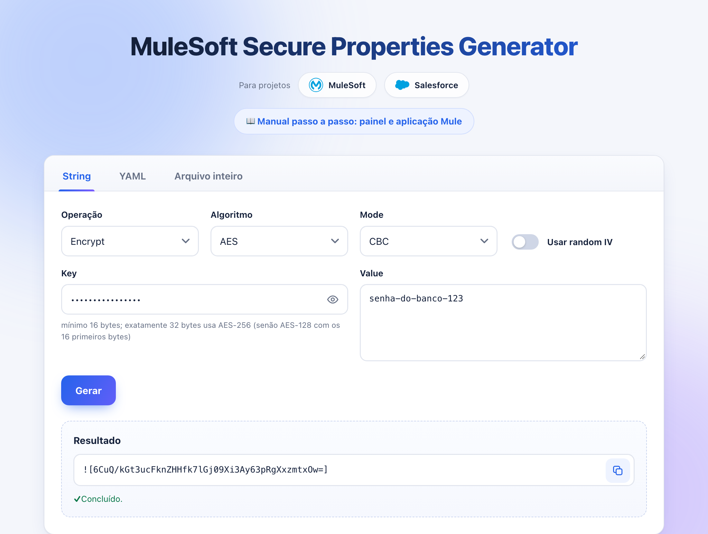
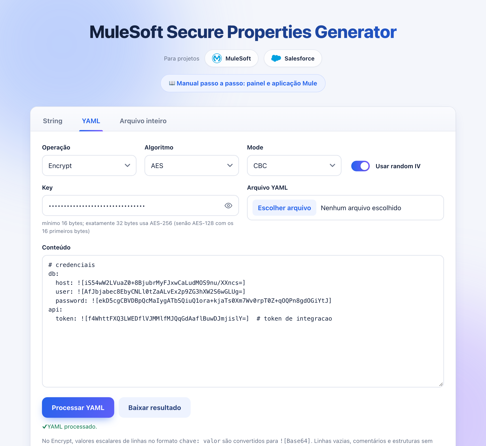

<div align="center">


# MuleSoft Secure Properties Generator

Criptografe e descriptografe propriedades seguras do MuleSoft (`![valor]`) direto no navegador,
compatível com a Secure Properties Tool oficial. Sem instalação, sem servidor e sem enviar a sua chave
para lugar nenhum.

[](LICENSE)


**[Acessar a ferramenta online](https://infosulst.com.br/properties/)** · [Manual passo a passo](https://infosulst.com.br/properties/manual.html)

<br />



</div>

## O que é

Uma página estática (HTML, CSS e JavaScript) que faz o mesmo que o comando
`java -cp secure-properties-tool.jar com.mulesoft.tools.SecurePropertiesTool`, mas sem precisar de Java
nem de linha de comando. Você escolhe o algoritmo, o mode e a chave, cola o valor e copia o resultado no
formato que o módulo *Secure Configuration Properties* do Mule 4 lê.

Não tem backend. Todo o processamento acontece no navegador, e a chave e os valores nunca saem da sua
máquina.

Principais pontos:

- Três modos de uso: **String** (um valor), **YAML** (arquivo inteiro) e **Arquivo inteiro** (qualquer
  arquivo, em Base64).
- Algoritmos **AES, Blowfish, DES, DESede (3DES) e RC2**, nos modes **CBC, CFB, ECB e OFB**, com padding
  PKCS5/PKCS7.
- IV aleatório opcional, equivalente ao `--use-random-iv` da ferramenta oficial.
- No YAML, só os valores `chave: valor` são trocados por `![...]`. Comentários, listas e linhas vazias
  são preservados.
- Botão para mostrar ou ocultar a chave, botão de copiar dentro do campo de resultado e erros em notificações (toast) no estilo iOS.
- Funciona offline, e até abrindo o `index.html` com duplo clique.
- [Manual passo a passo](manual.html) de como usar o painel e como configurar a aplicação Mule.

<div align="center">
  
</div>

## Como usar

Não há build nem dependências para rodar. Escolha uma das formas:

**Abrir direto.** Baixe o projeto e dê dois cliques no `index.html`.

```bash
git clone https://github.com/rsportella/sf-properties.git
cd sf-properties
open index.html        # macOS  (Linux: xdg-open index.html | Windows: start index.html)
```

**Servir a pasta** com qualquer servidor estático:

```bash
python3 -m http.server 8000
# http://localhost:8000
```

**Publicar.** Suba os arquivos para qualquer hospedagem de arquivos estáticos (GitHub Pages, Netlify,
Nginx, um bucket S3 etc.).

### Passo a passo no painel

1. Escolha a aba (**String**, **YAML** ou **Arquivo inteiro**).
2. Selecione a operação (*Encrypt* ou *Decrypt*), o algoritmo e o mode.
3. Informe a **chave**, a mesma que a aplicação Mule vai receber, e o conteúdo.
4. Clique em **Gerar** (ou **Processar**) e copie o resultado.

No Mule, o valor gerado vai no arquivo de propriedades, entre aspas, e é lido com o prefixo `secure::`:

```yaml
db:
  password: "![bAx40eFUVf/hIxbaV8/GaQ==]"
```

```xml
<secure-properties:config name="Secure_Properties_Config" file="secure-config.yaml" key="${mule.key}">
  <secure-properties:encrypt algorithm="AES" mode="CBC"/>
</secure-properties:config>

<!-- uso: password="${secure::db.password}" -->
```

O [manual](manual.html) cobre o resto: dependência do módulo, chave em tempo de execução (Studio,
linha de comando e CloudHub), erros comuns e boas práticas.

## Regras de chave e IV

Seguem o comportamento da Secure Properties Tool:

| Algoritmo | Chave mínima | Bytes usados da chave |
|---|---|---|
| AES | 16 bytes | 32 bytes → AES-256; 24 → AES-192; demais → AES-128 (16 primeiros bytes) |
| Blowfish | 16 bytes | até 56 bytes |
| DES | 16 bytes | 8 primeiros bytes |
| DESede | 24 bytes | 24 primeiros bytes |
| RC2 | 16 bytes | 16 primeiros bytes |

- **Sem IV aleatório:** o IV é fixo e igual aos primeiros bytes da chave (16 para AES, 8 para os demais).
- **Com IV aleatório:** um IV novo é gerado a cada operação e **vai na frente do texto cifrado** antes do
  Base64. Para descriptografar, marque a mesma opção.
- **ECB** não usa IV (a opção de IV aleatório fica desabilitada).
- A chave é lida como texto UTF-8, e o tamanho conta em bytes.

## Compatibilidade verificada

As 20 combinações (5 algoritmos × 4 modes) foram comparadas byte a byte com a saída do `openssl enc`, e o
ciclo completo de criptografar e descriptografar foi testado, com IV fixo e aleatório, para todas elas.

A aba **Arquivo inteiro** não foi validada contra a opção `fileLevelEncryption` do Mule. Para a aplicação
Mule, use as abas **String** e **YAML**.

## Segurança

- Todo o processamento acontece no navegador. Nenhuma requisição é feita com a sua chave ou os seus dados.
- DES, RC2 e os modes ECB, CFB e OFB existem por **compatibilidade** com o ecossistema MuleSoft. Em
  projetos novos, prefira **AES com CBC e IV aleatório** e uma chave de 32 caracteres.
- Não compartilhe a chave nem a cole em computadores que você não controla.

## Métricas de uso (opcional)

O `assets/js/analytics.js` integra o Google Analytics 4 com banner de consentimento (LGPD). Ele só age se houver um
ID configurado na constante `GA_ID`, no topo do arquivo. Se você faz fork e não quer métricas, deixe o
valor vazio (`''`).

- Nada é carregado antes do aceite, e a escolha pode ser revista em "Preferências de cookies" no rodapé.
- Eventos enviados: `tab_view`, `tool_run` (ferramenta, operação, algoritmo, mode, IV aleatório e
  sucesso/erro) e `copy_result`.
- **Nunca** são enviados chave, valores, conteúdo de YAML ou arquivos.
- IP anonimizado e sinais de publicidade desligados.

## Estrutura

```
.
├── index.html                  # página da ferramenta
├── manual.html                 # manual passo a passo (painel e aplicação Mule)
├── robots.txt
├── sitemap.xml
├── assets/
│   ├── css/
│   │   └── style.css           # estilos e animações
│   ├── js/
│   │   ├── app.js              # lógica da interface (abas, YAML, arquivos)
│   │   ├── toast.js            # notificações de erro no estilo iOS
│   │   ├── effects.js          # efeitos visuais, copiar resultado, mostrar/ocultar chave
│   │   ├── manual.js           # botão de copiar nos blocos de código do manual
│   │   ├── analytics.js        # Google Analytics 4 com consentimento
│   │   └── crypto.bundle.js    # motor de criptografia (gerado, não edite)
│   └── img/
│       ├── og-image.png        # imagem de compartilhamento (1200×630)
│       ├── favicon.svg
│       ├── apple-touch-icon.png
│       ├── icon.svg            # ícone do README
│       ├── painel-*.png        # capturas de tela do README
│       └── *.svg               # ícones de redes sociais
├── src/
│   └── crypto-entry.js         # fonte do motor de criptografia
├── LICENSE
└── THIRD-PARTY-NOTICES.md
```

## Desenvolvimento

O `assets/js/crypto.bundle.js` é gerado a partir do `src/crypto-entry.js`. Só é preciso refazê-lo se você mexer no
motor de criptografia:

```bash
npm install
npm run build
```

O restante (HTML, CSS e JavaScript em `assets/`) é editado direto, sem etapa de build.

## Bibliotecas de terceiros

O bundle embute, de forma reduzida (só os módulos usados):

- [node-forge](https://github.com/digitalbazaar/forge): AES, DES, 3DES e RC2 (BSD-3-Clause).
- [egoroof-blowfish](https://github.com/egoroof/blowfish): Blowfish (MIT).

Os modes CFB e OFB para RC2 e Blowfish são implementados aqui sobre a cifra de bloco. Os textos das
licenças estão em [THIRD-PARTY-NOTICES.md](THIRD-PARTY-NOTICES.md).

## Marcas

MuleSoft e Salesforce são marcas de seus respectivos titulares. Este projeto não possui vínculo com essas
empresas nem endosso delas; os nomes são usados apenas para indicar compatibilidade.

## Licença

[MIT](LICENSE) © Rodolfo Portella

---

<div align="center">
  <sub>Desenvolvido por <strong>RSPortella</strong></sub>
  <br /><br />
  <a href="https://github.com/rsportella" title="GitHub"></a>
  &nbsp;
  <a href="https://www.linkedin.com/in/rsportella/" title="LinkedIn"></a>
  &nbsp;
  <a href="https://www.instagram.com/rsportella/" title="Instagram"></a>
  &nbsp;
  <a href="mailto:rodolfosportella@gmail.com" title="rodolfosportella@gmail.com"></a>
  <br />
  <sub><a href="mailto:rodolfosportella@gmail.com">rodolfosportella@gmail.com</a></sub>
</div>
